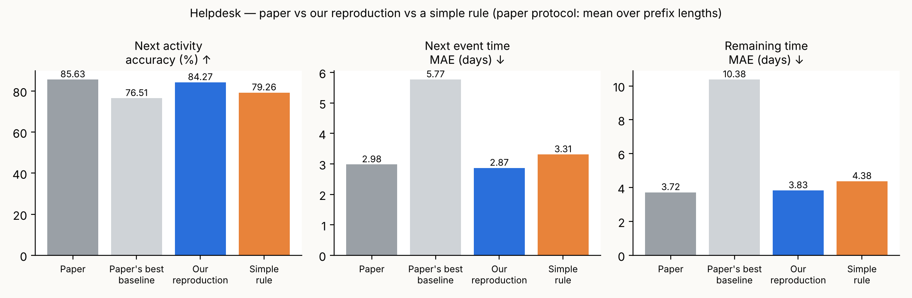

# Reproducing ProcessTransformer — AI for business process prediction

**Student:** Jules Amimer — MSc AI for Business (NEOMA x INSA)
**Paper:** Bukhsh, Saeed & Dijkman (2021). *ProcessTransformer: Predictive Business Process Monitoring with Transformer Network.* [arXiv:2104.00721](https://arxiv.org/abs/2104.00721) — [official code](https://github.com/Zaharah/processtransformer)

## Why this paper
Companies record every step of their processes (tickets, orders, loan applications) in event logs. **Predictive Business Process Monitoring** uses these logs to predict how a running case will continue: *what happens next, when, and when will the case be finished?* This paper applies a Transformer — the architecture behind modern language models — to this problem. It is a concrete example of AI embedded in an operational business process, which is the core of AI consulting.

## What I did
1. Read the paper and mapped the state of the art → [`docs/paper_notes.md`](docs/paper_notes.md), [`docs/state_of_the_art.md`](docs/state_of_the_art.md)
2. Reproduced the 3 tasks on the **Helpdesk** event log (4,580 cases, 21,348 events, 14 activities) with the **official code** → [`notebooks/ProcessTransformer_reproduction.ipynb`](notebooks/ProcessTransformer_reproduction.ipynb)
3. Fixed 2 compatibility issues needed to run the 2021 code in 2026 → [`code/compatibility_fixes.patch`](code/compatibility_fixes.patch)
4. Audited the evaluation code (averaging over prefix lengths, a bug in the summary row)
5. **Extension:** compared the Transformer with simple frequency rules on the same split → [`code/baselines.py`](code/baselines.py)
6. Documented everything day by day → [`logbook.md`](logbook.md)

## Results (Helpdesk)

| Metric | Paper | Our reproduction (paper protocol) | Weighted by # test cases | Simple rule (weighted) |
|---|---|---|---|---|
| Next activity accuracy | 85.63% | 83.69% ± 0.77 (3 runs) | 80.07% | 79.70% |
| Next event time MAE | 2.98 days | 2.88 ± 0.02 (2 runs) | 4.14 days | 5.16 days |
| Remaining time MAE | 3.72 days | 3.98 ± 0.21 (2 runs) | 5.37 days | 6.48 days |

**Key findings**
- The official code reproduces the paper closely (time tasks within 0.1–0.3 days, next activity about 2 points below).
- The paper averages metrics over prefix lengths, so a prefix length with 1 test case weighs as much as one with 916. Counting every case once lowers accuracy by about 3.6 points.
- For next activity, a simple rule ("most frequent next step after the last activity") is almost as accurate as the Transformer. For time predictions, the Transformer saves about 1 day of error.
- The 2021 code needed 2 one-line fixes to run with 2026 libraries, and the evaluation script has a small bug in its summary row.



## Repository structure
```
├── README.md                 ← this file
├── logbook.md                ← day-by-day work log
├── docs/                     ← paper notes, state of the art, peer-evaluation template
├── notebooks/                ← Colab notebook (end-to-end reproduction)
├── code/                     ← compatibility patch, baselines, analysis script, run script
├── results/                  ← CSV results and figures
├── slides/                   ← presentation (pitch 24/11 + final)
└── report/                   ← final report (Markdown + PDF)
```

## How to reproduce
Open the notebook in Google Colab and run all cells (CPU is enough, ~30–40 min for the 3 tasks at 100 epochs).

Locally:
```bash
git clone https://github.com/Zaharah/processtransformer.git && cd processtransformer
pip install tf-keras && export TF_USE_LEGACY_KERAS=1
patch -p1 < ../code/compatibility_fixes.patch
# put helpdesk.csv in datasets/helpdesk/
for t in next_activity next_time remaining_time; do python data_processing.py --dataset=helpdesk --task=$t; done
python next_activity.py --dataset=helpdesk --epochs=100
python next_time.py --dataset=helpdesk --epochs=100
python remaining_time.py --dataset=helpdesk --epochs=100
python ../code/baselines.py datasets/helpdesk/processed ../results/baselines_next_activity.csv
python ../code/analyze_results.py results/helpdesk datasets/helpdesk/processed ../results
```

## Licence and credits
The model code belongs to its authors (MIT licence). Helpdesk event log: Verenich (2016), 4TU.ResearchData. My additions (notebook, baselines, analysis, documents) are released under MIT.
