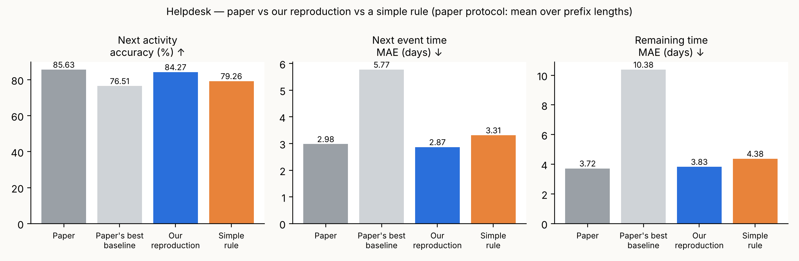
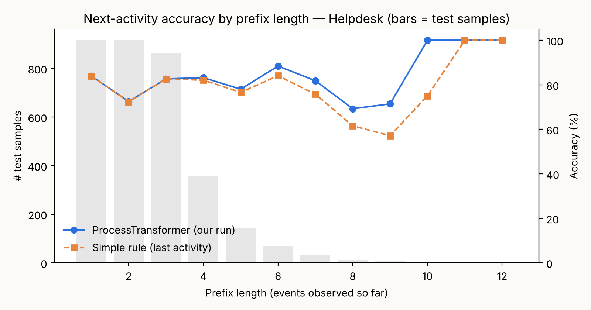

# 1. Introduction

Every business process leaves traces in IT systems: a support ticket is created, assigned, escalated, solved and closed, and each step is recorded with a timestamp. These records, called **event logs**, make it possible to use machine learning to predict how a running case will continue. This field is called **Predictive Business Process Monitoring (PBPM)**.

For a company, the value is concrete. If we know early that a ticket is likely to be escalated, or that it will not be solved before the deadline in the service-level agreement (SLA), managers can reallocate staff, warn the customer or prioritise the case.

This project reproduces the paper *ProcessTransformer: Predictive Business Process Monitoring with Transformer Network* (Bukhsh, Saeed & Dijkman, 2021). The paper applies the Transformer architecture to three PBPM tasks: predicting the next activity, the time until the next event, and the remaining time of a case. I chose it because it connects directly to my professional objective, AI consulting: it is a clear example of how AI can be embedded into an operational business process.

My goals were to (1) understand the paper and its state of the art, (2) reproduce its results on the Helpdesk event log with the official code, and (3) critically assess the results, in particular by comparing the model with simple baselines that a business analyst could build without deep learning.

# 2. State of the art

**Process mining.** Process mining discovers process models (for example transition systems or Petri nets) from event logs. Early predictive approaches annotated these models with statistics, such as the average remaining time from each state. They are interpretable but depend on the quality of the discovered model.

**Classical machine learning.** Running cases are encoded into fixed-size feature vectors (activity counts, last activity, elapsed time) and fed to models such as random forests or gradient boosting. Results depend heavily on feature engineering.

**Deep learning.** From 2017, recurrent neural networks became the reference. Evermann et al. (2017) used an LSTM with embeddings for next-event prediction; Tax et al. (2017) proposed an LSTM with one-hot encoding that predicts the next activity, its timestamp and the remaining time, and became the standard baseline; Navarin et al. (2017) focused on remaining time; Camargo et al. (2019) combined categorical and numerical attributes. Other architectures were tested: memory-augmented networks (Khan et al., 2018), convolutional networks (Di Mauro et al., 2019; Pasquadibisceglie et al., 2019) and GANs (Taymouri et al., 2020).

**Limits addressed by the paper.** According to the authors, LSTM-based models struggle with long traces, process events sequentially (slow training), and often require hand-crafted features or task-specific designs.

**Contribution of ProcessTransformer.** The paper applies the Transformer (Vaswani et al., 2017) to event logs. Self-attention relates all events of a prefix at once, which captures long-range dependencies and allows parallel training. The same architecture is used for the three tasks, with only the sequence of activities as input (plus three time features for the time tasks).

**Open issue: comparability.** Papers in this field use different preprocessing, data splits and metrics, which makes published numbers hard to compare. The authors acknowledge this themselves, and benchmark studies in the field make the same point.

# 3. The method

- **Input:** the prefix of a running case (the activities observed so far), encoded as integers and zero-padded.
- **Architecture:** token embedding + positional embedding (36 dimensions), one Transformer block (4 attention heads, feed-forward layer, residual connections, layer normalisation, dropout), global pooling, dense layers and an output layer.
- **Time tasks:** three numerical features are added: time since the previous event, time since the event before, and time since case start.
- **Training:** Adam optimiser; cross-entropy loss for next activity, log-cosh loss for the time tasks.
- **Evaluation:** 80/20 split of cases; metrics computed for each prefix length *k* and then averaged over *k*. Accuracy and weighted F1 for next activity, mean absolute error (MAE) in days for the time tasks.

# 4. Reproduction protocol

**Data.** Helpdesk event log of an Italian software company (4TU repository): 4,580 cases, 21,348 events, 14 activities, matching Table 1 of the paper. After preprocessing: 13,443 training and 3,325 test prefixes for next activity; 17,107 and 4,241 for the time tasks.

**Code.** Official repository of the authors (github.com/Zaharah/processtransformer), run with the commands given in its README (100 epochs, default batch size 12 and learning rate 0.001).

**Environment.** Python 3.13, TensorFlow 2.21 with the legacy Keras 2 API (`tf-keras`), pandas 3, NumPy 2, CPU only.

**Changes needed to run the code.** The model, training and evaluation were not modified. Two one-line fixes in the preprocessing were necessary:

1. The timestamps (`2012/10/09 14:50:17`) were parsed with `dayfirst=True`. With current pandas this crashes; with other versions it could silently swap day and month, corrupting all time features. I used `dayfirst=False`.
2. `np.array_split` no longer returns DataFrames with NumPy 2, which broke the preprocessing; I split row indices instead.

**Differences between the paper and the code.** The paper reports a learning rate of 10⁻², global max-pooling and dense layers of 32 and 128 units; the published code uses a learning rate of 10⁻³, global average pooling and a 64-unit dense layer for next activity, with 10 epochs by default (100 in the README). I followed the published code and README.

**Evaluation issues found.** (a) The summary row written by `next_activity.py` contains the accuracy of the last prefix length instead of the mean, and this row is included in the printed average; I recomputed all averages from the per-prefix results. (b) Averaging over prefix lengths gives the same weight to *k* = 0 (916 test samples) and to the longest prefix (1 sample). I therefore report both the paper's average and an average weighted by the number of samples. (c) The split uses the first 80% of cases in file order rather than an explicit chronological sort.

**Extension: simple baselines.** To measure the real added value of the Transformer, I implemented simple frequency-based baselines on exactly the same split and metrics (`code/baselines.py`):

- *Majority:* always predict the most frequent next activity.
- *Last activity:* predict the most frequent next activity observed after the last activity of the prefix (a first-order Markov model).
- *Prefix lookup:* predict the most frequent next activity after the full prefix, falling back to the last-activity rule for unseen prefixes.
- *Time tasks:* predict the mean training value given the last activity, or given the pair (prefix length, last activity).

# 5. Results

## 5.1 Reproduction of the paper's numbers

Table 1 compares the paper with my runs, using the paper's protocol (metric computed per prefix length, then averaged). Next activity was trained 3 times, the time tasks 2 times (CPU time was the limit).

| Metric (Helpdesk) | Paper | Our runs (mean ± std) | Paper's best baseline |
|---|---|---|---|
| Next activity accuracy (%) | 85.63 | 83.69 ± 0.77 (3 runs) | 76.51 |
| Next activity weighted F1 | 0.82 | 0.80 ± 0.01 (3 runs) | — |
| Next event time MAE (days) | 2.98 | 2.88 ± 0.02 (2 runs) | 5.77 |
| Remaining time MAE (days) | 3.72 | 3.98 ± 0.21 (2 runs) | 10.38 |

*Table 1 — Paper vs reproduction (paper protocol: average over prefix lengths).*

The reproduction is **successful for the time tasks** (within about 0.1–0.3 days of the paper) and **close for next activity** (about 2 points below). Interestingly, the "average accuracy" printed by the official script was 85.48%, 84.14% and 85.21% for my three runs (mean 84.94%), which is closer to the paper. This printed value includes the summary-row bug described in Section 4: it adds the accuracy of the longest prefix (100% here, measured on a single test case) as an extra value in the average. I cannot verify whether the published number was computed this way, but it would explain part of the gap.

## 5.2 Effect of the averaging method

Prefix lengths are very unbalanced in the test set: 916 test samples for prefixes of 1 and 2 events, 865 for 3 events, then 357, 141, 69, 33, 13, 7, 4, 3 and finally 1 sample for the longest prefix. When every test sample counts once (weighted average), results change a lot:

| Metric | Paper protocol (mean over k) | Weighted by # samples |
|---|---|---|
| Next activity accuracy (%) | 83.69 | 80.07 ± 0.25 |
| Next activity weighted F1 | 0.80 | 0.74 |
| Next event time MAE (days) | 2.88 | 4.14 ± 0.15 |
| Remaining time MAE (days) | 3.98 | 5.37 ± 0.04 |

*Table 2 — Same predictions, two ways of averaging (mean of runs).*

The paper's protocol gives a more optimistic picture, because long prefixes, which are rare, are easier to predict at the end of a case and receive a large weight.

## 5.3 Comparison with simple baselines

| Model | Accuracy, mean over k | Accuracy, weighted | Weighted F1 |
|---|---|---|---|
| Majority class | 26.2% | 29.7% | 0.14 |
| **Simple rule: last activity** | 79.3% | 79.7% | 0.75 |
| Prefix lookup | 79.1% | 80.2% | 0.76 |
| ProcessTransformer (3 runs) | 83.7% | 80.1% | 0.74 |

*Table 3 — Next activity on Helpdesk, same split.*

| Model | Next time MAE, mean over k | weighted | Remaining time MAE, mean over k | weighted |
|---|---|---|---|---|
| Global mean | 9.50 | 10.68 | 17.51 | 14.76 |
| Mean by last activity | 4.09 | 5.36 | 5.70 | 6.68 |
| **Mean by (prefix length, last activity)** | 3.31 | 5.16 | 4.38 | 6.48 |
| ProcessTransformer | 2.88 | 4.14 | 3.98 | 5.37 |

*Table 4 — Time tasks on Helpdesk, same split (MAE in days).*

Three observations:

1. **For next activity, a frequency rule is almost as good as the Transformer.** Counting every test case once, the rule "predict the most frequent next activity after the last one" reaches 79.7% accuracy and the prefix lookup 80.2%, against 80.1% for ProcessTransformer. The paper's advantage appears mainly with its averaging method.
2. **The simple rules already beat all deep-learning baselines reported in the paper for Helpdesk** (best: 76.51% accuracy, 5.77 and 10.38 days MAE). This suggests that part of the gap reported in the paper comes from differences in protocol, not only from the architecture.
3. **For the time tasks, the Transformer adds real value:** about 1 day less error than the best simple rule on both tasks (weighted: 4.14 vs 5.16 days, and 5.37 vs 6.48 days). This is consistent with the fact that the model receives time features in addition to activities.

The figure explains observation 1: for prefixes of 1 to 3 events (about 80% of test cases), the Transformer and the simple rule make almost exactly the same predictions. The Transformer is better only on long cases, where few test samples exist.

# 6. Discussion

**Was the reproduction successful?** Yes, overall. With the official code and the same data, I obtained results close to the paper for the three tasks, especially the time tasks. The main gap (next activity, about 2 points) is small and partly explained by an evaluation bug.

**Reproducibility in practice.** Reproducing a 2021 paper in 2026 required effort that is not visible in the paper: finding the exact dataset version (a filtered Helpdesk version with 3,804 cases circulates online and gives different results), installing a legacy Keras API, and fixing two preprocessing lines. The date-parsing issue is the most dangerous: depending on library versions, it can either crash or silently swap day and month and corrupt the time features without any error message.

**Differences between paper and code.** The learning rate, pooling and dense layers in the code differ from the paper. I followed the code; testing the paper's settings is a next step.

**The evaluation protocol matters as much as the model.** Averaging per prefix length gives the same weight to 1 test case as to 916. This choice inflates next-activity accuracy by about 3.6 points and lowers MAE by 1.2–1.4 days compared with a sample-weighted average. Both views are legitimate (the paper's view gives equal importance to every stage of a case), but they should be reported together.

**Is deep learning worth it here?** For next activity on Helpdesk, not really: the process is very repetitive (14 activities, short cases), so a frequency table captures almost all the predictable structure. For time predictions, the Transformer brings a clear improvement of about one day. On more complex logs (longer cases, more activities, such as BPIC 2012), the gap with simple rules may be larger; this is worth testing.

**Limitations of my work.** Only one dataset (Helpdesk); 2–3 runs per task, on CPU; default hyperparameters of the code, no tuning; the train/test split follows the official code (file order) rather than an explicit chronological sort.

# 7. Business perspective

From a consulting point of view, this reproduction gives three practical lessons for a company that wants to use AI in its processes.

1. **Start with the data.** Event logs already exist in most ERP, CRM and ticketing tools. The main work is to extract them with a clean case ID, activity and timestamp, and to check data quality (dates are a classic trap, as shown by the parsing issue above).
2. **Always benchmark against a simple rule.** For a repetitive process like Helpdesk, a frequency table already gives most of the predictive value. It is cheap, transparent and easy to explain to operational teams. A deep-learning model is justified only if the extra accuracy has a measurable business value (fewer SLA breaches, better staffing) or if the process is more complex and variable.
3. **Plan for maintenance.** Code written in 2021 no longer ran in 2026 without fixes. In production, dependencies must be pinned, the model monitored and retrained when the process changes.

# 8. Conclusion

I reproduced ProcessTransformer on the Helpdesk event log with the authors' code. The reproduced results are close to the published ones: 83.7% vs 85.6% for next-activity accuracy, 2.88 vs 2.98 days for next-event time and 3.98 vs 3.72 days for remaining time.

The audit and the extension change how these numbers should be read. Counting every test case once, the Transformer (80.1%) is no better than a simple frequency rule (79.7–80.2%) for next activity, while it does reduce time-prediction errors by about one day. For a company, the message is clear: AI can predict how a business process will continue, but its value must be measured against a simple, transparent benchmark, on the right metric, before it is deployed.

**Next steps:** test the learning rate reported in the paper, run the same experiment on BPIC 2012, and add a third run for the time tasks.

# References

- Bukhsh, Z. A., Saeed, A., & Dijkman, R. M. (2021). ProcessTransformer: Predictive Business Process Monitoring with Transformer Network. arXiv:2104.00721.
- Camargo, M., Dumas, M., & González-Rojas, O. (2019). Learning accurate LSTM models of business processes. BPM 2019.
- Di Mauro, N., Appice, A., & Basile, T. M. A. (2019). Activity prediction of business process instances with inception CNN models. AI*IA 2019.
- Evermann, J., Rehse, J.-R., & Fettke, P. (2017). Predicting process behaviour using deep learning. Decision Support Systems, 100.
- Khan, A., et al. (2018). Memory-augmented neural networks for predictive process analytics. arXiv:1802.00938.
- Navarin, N., Vincenzi, B., Polato, M., & Sperduti, A. (2017). LSTM networks for data-aware remaining time prediction of business process instances. IEEE SSCI 2017.
- Pasquadibisceglie, V., Appice, A., Castellano, G., & Malerba, D. (2019). Using convolutional neural networks for predictive process analytics. ICPM 2019.
- Tax, N., Verenich, I., La Rosa, M., & Dumas, M. (2017). Predictive business process monitoring with LSTM neural networks. CAiSE 2017.
- Taymouri, F., La Rosa, M., Erfani, S., Bozorgi, Z. D., & Verenich, I. (2020). Predictive business process monitoring via generative adversarial nets. BPM 2020.
- Vaswani, A., et al. (2017). Attention is all you need. NeurIPS 2017.
- Verenich, I. (2016). Helpdesk event log. 4TU.ResearchData.
