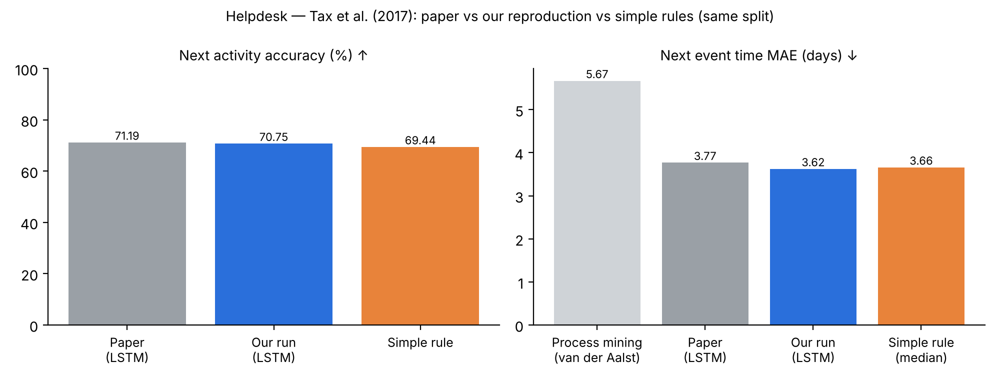
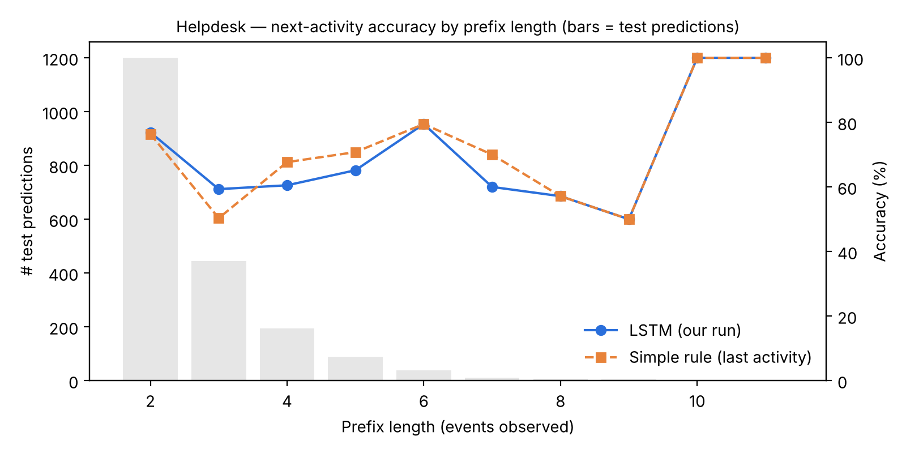

# 1. Introduction

Every business process leaves traces in IT systems: a support ticket is created, assigned, solved and closed, and each step is recorded with a timestamp. These records, called **event logs**, make it possible to predict how a running case will continue. This field is called **predictive business process monitoring**.

For a company, the value is concrete: knowing early what will happen next in a case, and when, helps to respect service-level agreements, allocate staff and warn customers before a delay.

This project reproduces *Predictive Business Process Monitoring with LSTM Neural Networks* (Tax, Verenich, La Rosa & Dumas, CAiSE 2017). I chose it because it is the **pillar paper of the field** (738 citations according to OpenAlex in November 2026, and the standard baseline of later work) and because it connects directly to my professional objective, AI consulting: embedding AI in operational business processes.

My goals were to (1) understand the paper and its state of the art, (2) reproduce its main results with the official code, and (3) assess them critically, in particular by comparing the model with simple rules that a business analyst could build without deep learning.

# 2. State of the art

**Before 2017, one method per task.** For time prediction, van der Aalst et al. (2011) built transition systems from the log, where each state (the set, bag or sequence of activities seen so far) is annotated with observed times. For the next activity, Breuker et al. (2016) learned probabilistic models of the process. Evermann et al. (2016) were the first to use an LSTM, with embeddings inspired by language models. According to Tax et al., these methods were tailor-made for one task, and their accuracy varied a lot across logs.

**Contribution of Tax et al. (2017).** One LSTM architecture for several tasks (next activity, next event time, suffix, remaining time), using multi-task learning with shared and task-specific layers. It outperformed all the baselines above on two real logs.

**After 2017.** Later approaches compare to Tax et al.: richer LSTMs (Camargo et al., 2019), CNNs (Di Mauro et al., 2019; Pasquadibisceglie et al., 2019), GANs (Taymouri et al., 2020) and Transformers (Bukhsh et al., 2021). Benchmark studies later showed that differences in splits and metrics make published numbers hard to compare.

# 3. The method

- **Input:** for each event of the prefix, a one-hot encoding of the activity and time features (time since the previous event, time since the case start, time within the day, day of the week, position in the case).
- **Architecture of the published code:** one shared LSTM layer (100 units) followed by two specialised LSTM layers, one for the next activity (softmax over activities plus an end-of-case symbol) and one for the time until the next event (regression). Batch normalisation and dropout (0.2).
- **Training:** Nadam (learning rate 0.002, gradient clipping), cross-entropy and MAE losses, early stopping with patience 42, up to 500 epochs, 20% of the training prefixes for validation.
- **Evaluation:** chronological split (first 2/3 of cases for training, last 1/3 for testing); prediction for every prefix of length 2 ≤ k < case length; accuracy and MAE in days averaged over all predictions.

# 4. Reproduction protocol

**Data.** The two logs of the authors' repository: Helpdesk (3,804 cases, 13,710 events, 9 activities, as in the paper) and BPI'12 W (9,658 cases, 72,413 events, 6 activities).

**Code.** Official repository (github.com/verenich/ProcessSequencePrediction), configuration as published: LSTM, 2 layers, 1 shared, 100 units. Its target values in Table 1 of the paper are 0.7119 accuracy and 3.77 days MAE on Helpdesk, and 0.7600 and 1.56 days on BPI'12 W.

**Port to Python 3.** The code was written for Python 2.7 and Keras 2.0 and no longer runs. I made a minimal port to Python 3 and `tf-keras` (Keras 2 API): imports, Python 2 syntax (`izip`, `unichr`, `unicode`), file modes, and the log name passed as an argument (48 changed lines in `train.py`, 28 in the evaluation script). The model, features, split, training and evaluation were not modified.

**Environment.** Python 3.13, TensorFlow 2.21 with `tf-keras`, CPU (2 cores).

**Bug found in the evaluation script.** When reading the log, the lists of timestamps `times2` and `times3` are never reset between cases. All cases therefore share one list, and every test case receives the timestamps of the first events of the log. As a result, the time-of-day and day-of-week features are wrong at test time (but correct during training). I wrote `evaluate_fixed.py`, which adds the two missing resets, to measure the effect.

**Paper vs code.** The paper mentions the Adam optimiser; the code uses Nadam. I followed the code.

**Extension: simple baselines.** On exactly the same split and prefixes (1,993 test predictions on Helpdesk, as in the official script), I implemented: the majority class; the most frequent next activity after the last activity; the most frequent next activity after the full prefix; and, for time, the mean or median time to the next event, globally, by last activity, or by (prefix length, last activity).

# 5. Results

## 5.1 Reproduction on Helpdesk

| | Accuracy | MAE (days) |
|---|---|---|
| Paper (published configuration) | 71.19% | 3.77 |
| Run 1 (interrupted at epoch 53, best checkpoint: epoch 26) | 71.00% | 3.62 |
| **Run 2 (early stopping at epoch 62, best epoch 20)** | **70.75%** | **3.62** |
| Run 2, evaluation bug fixed | 70.70% | 3.62 |

The reproduction is successful: about 0.2–0.4 points below the paper in accuracy and 0.15 days better in MAE. The bug in the evaluation script has almost no effect (−0.05 point), which suggests that the model relies very little on the time-of-day and day-of-week features.

## 5.2 Comparison with simple baselines

| Model (same split) | Helpdesk accuracy | Helpdesk MAE | BPI'12 W accuracy | BPI'12 W MAE |
|---|---|---|---|---|
| Majority class | 18.7% | — | 36.1% | — |
| **Most frequent next activity after the last one** | 69.4% | — | **78.7%** | — |
| Most frequent next activity after the full prefix | 69.4% | — | 76.4% | — |
| Global median time | — | 3.88 | — | 1.77 |
| **Median time after the last activity** | — | 3.66 | — | 1.57 |
| Median time by (prefix length, last activity) | — | 3.72 | — | 1.56 |
| LSTM — our run (Helpdesk) / paper (BPI'12 W) | 70.8% | 3.62 | 76.0% | 1.56 |
| Best earlier methods reported in the paper | — | 5.67 | 71.9% | 1.91 |

Three observations:

1. **On Helpdesk, the LSTM is only slightly better than a frequency rule:** +1.3 points of accuracy and the same time error (3.62 vs 3.66 days).
2. **The simple rules beat the earlier methods reported in the paper** (e.g. 3.66 vs 5.67 days on Helpdesk; 78.7% vs 71.9% on BPI'12 W). Part of the progress attributed to the LSTM could therefore be obtained with much simpler models.
3. **On BPI'12 W, the frequency rule (78.7%) is above the LSTM accuracy reported in the paper (76.0%).** This must be confirmed by training the LSTM on BPI'12 W ourselves (planned on a GPU).

By prefix length, the LSTM and the rule are almost identical for prefixes of 2 events (76.9% vs 76.4%), which represent 60% of the test predictions. The LSTM is clearly better for prefixes of 3 events (59.3% vs 50.3%) and worse for 4–5 events.

# 6. Discussion

*To be completed in December, after the BPI'12 W run and several runs on Helpdesk.* Points already identified:

- **Reproducibility:** with the authors' code and data, the published numbers are reproduced closely; the main effort was technical (Python 2 → 3).
- **Hidden bugs:** a bug in the evaluation script went unnoticed because it barely changes the results.
- **Value of deep learning:** on these two logs, much of the predictive power is captured by the last activity alone. For a company, the extra accuracy of an LSTM must be weighed against its cost, opacity and maintenance.

# 7. Business perspective

1. **Start with the data:** event logs already exist in ERP, CRM and ticketing tools; the main work is to extract clean case IDs, activities and timestamps.
2. **Benchmark against a simple rule first:** a frequency table is cheap, transparent and, here, almost as accurate.
3. **Plan for maintenance:** code from 2017 no longer ran in 2026 without changes.

# 8. Conclusion

*Draft.* I reproduced the main result of Tax et al. (2017) on Helpdesk with the official code: 70.75% accuracy and 3.62 days MAE versus 71.19% and 3.77 days in the paper. A simple rule based on the last activity is almost as good, which is a useful message for any company considering AI for process prediction. **Next steps:** LSTM on BPI'12 W, several runs, and (optionally) suffix and remaining-time prediction.

# References

- Tax, N., Verenich, I., La Rosa, M., & Dumas, M. (2017). Predictive business process monitoring with LSTM neural networks. CAiSE 2017, LNCS, 477–492. arXiv:1612.02130.
- van der Aalst, W. M. P., Schonenberg, M. H., & Song, M. (2011). Time prediction based on process mining. Information Systems, 36(2).
- Breuker, D., Matzner, M., Delfmann, P., & Becker, J. (2016). Comprehensible predictive models for business processes. MIS Quarterly, 40(4).
- Evermann, J., Rehse, J.-R., & Fettke, P. (2017). Predicting process behaviour using deep learning. Decision Support Systems, 100.
- Camargo, M., Dumas, M., & González-Rojas, O. (2019). Learning accurate LSTM models of business processes. BPM 2019.
- Bukhsh, Z. A., Saeed, A., & Dijkman, R. M. (2021). ProcessTransformer: Predictive business process monitoring with Transformer network. arXiv:2104.00721.
